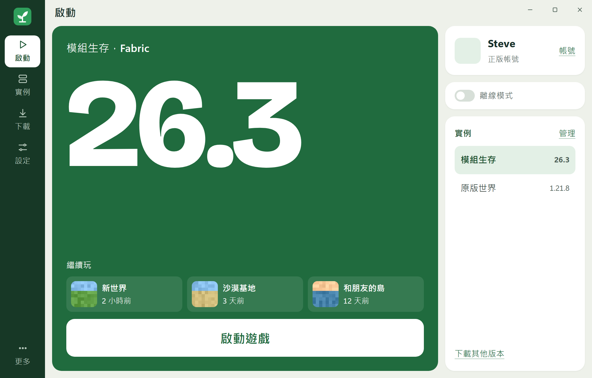
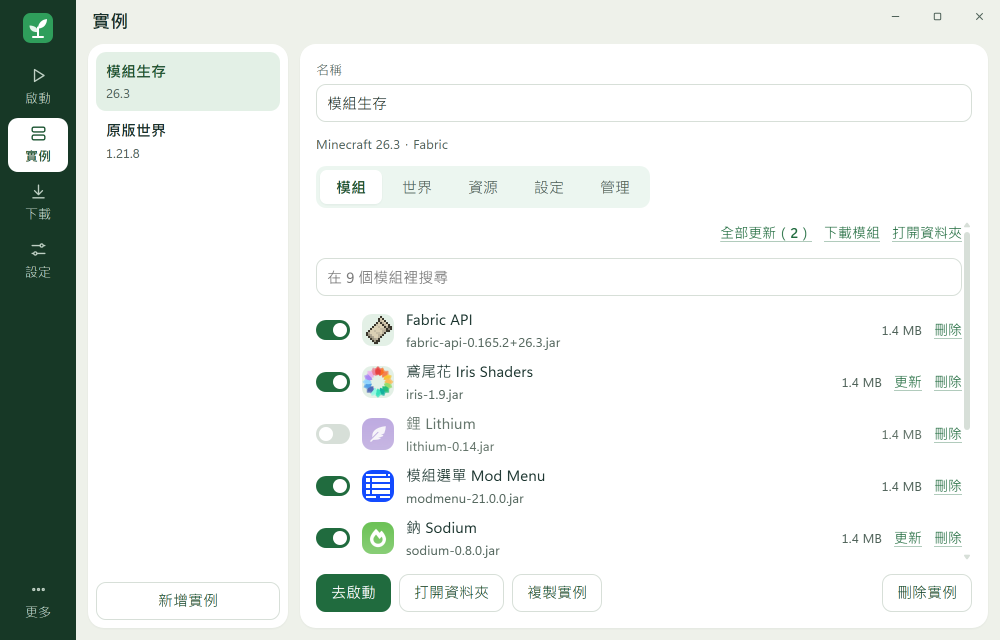

<p align="center"></p>

<h1 align="center">Sapling Launcher</h1>

<p align="center">樹苗：一個簡單好用的 Minecraft Java 版啟動器（簡稱 SPL）</p>

<p align="center">
  <a href="https://github.com/PZW152/sapling/releases/latest"></a>
  <a href="https://github.com/PZW152/sapling/actions/workflows/ci.yml"></a>
</p>

<p align="center"></p>

Sapling 是為 Windows 做的 Minecraft Java 版啟動器：單一 exe，放進資料夾就能用，打開後一兩步就能進遊戲。

## 功能

**玩遊戲**

- 用正版微軟帳號登入，重開後保持登入，可以保存多個帳號並切換
- 支援 1.7.10 及以後的正式版，遊戲檔案和所需的 Java 自動下載，全部用 SHA1 校驗
- 首頁顯示最近玩過的世界，1.20 以上按一下直接進入
- 已安裝的版本沒有網路也能啟動
- 每個實例可以設定記憶體、遊戲窗口大小、全螢幕和 Java
- 離線模式：這台電腦登入過擁有遊戲的微軟帳號後，可以用自訂名稱玩單人遊戲和區域網路

**模組和整合包**

- 支援 Fabric、NeoForge 和 Forge
- 在啟動器內搜尋和安裝 Modrinth 的模組、資源包、光影和資料包，前置模組自動一起裝好
- 檢查模組更新，一鍵全部更新
- 一鍵安裝 Modrinth 整合包，也可以匯入和匯出 `.mrpack`
- 把模組、資源包、光影或整合包拖進窗口就能安裝

**管理**

- 多實例：每個實例有獨立的存檔、模組和設定，可以複製，也可以更換遊戲版本
- 備份世界，並從官方啟動器或舊版 Sapling 匯入世界
- 共用遊戲檔案：相同的檔案不重複下載，用不到的可以一鍵清理
- 遊戲異常結束時，用白話說明可能原因，也可以一鍵修復遊戲檔案
- 自動更新、自動分配記憶體

**好看也好用**

- 五種綠色主題，支援深色模式
- 三種介面大小，支援鍵盤操作、讀屏軟體和 Windows 高對比模式

<p align="center"></p>

你需要擁有正版 Minecraft Java 版。Sapling 不支援盜版，也沒有免帳號登入。

## 安裝

到 [Releases](https://github.com/PZW152/sapling/releases) 下載最新版本。

下載 `portable.exe`，放進一個資料夾後直接打開，不需要安裝。遊戲和設定會存在同一個資料夾的 `Sapling Data` 裡。

目前只支援 Windows 11 x64。

Sapling 是學生的個人專案，沒有購買數位簽章，所以第一次打開時 Windows 可能顯示「Windows 已保護您的電腦」。按「其他資訊」再按「仍要執行」就能打開。想確認檔案沒被改過，可以比對 Release 頁面上的 SHA256，程式碼也都公開在這裡。

下載會走 Windows 的系統代理。連不上官方伺服器時，請先開啟代理或加速器。

Sapling 目前是早期版本，1.0.0 才是第一個基礎版本，詳見 [版本號規範](VERSIONING.md) 和 [設計與開發原則](DESIGN.md)。

## 從原始碼建置

需要 Rust（MSVC 工具鏈）、Node.js 和 Microsoft C++ Build Tools。

```bash
cd app
npm install
npm run tauri dev
```

## 授權

Copyright (c) 2026 PZW152。本專案代碼公開，但不是標準開源軟體。

歡迎學習和善意參考：少量參考請署名；修改版和大量參考必須遵守 [善意使用指南](USAGE.md)，包括說明是第三方作品、公開原始碼和不收費。不可以冒充官方、倒賣，或用於訓練 AI。

完整條款見 [LICENSE](LICENSE)，AI 工具請參閱 [AGENTS.md](AGENTS.md)。

## 聲明

非 Minecraft 官方產品，與 Mojang 和 Microsoft 無關。模組和整合包資料來自 [Modrinth](https://modrinth.com)。
