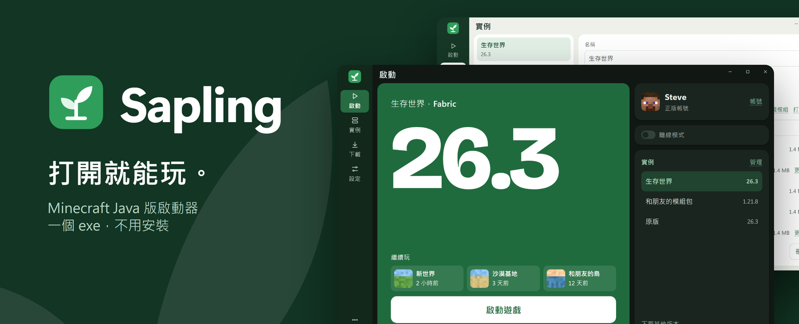
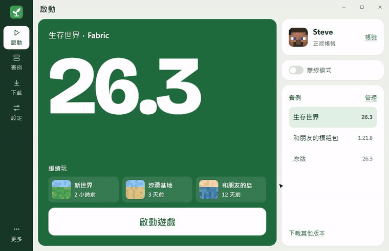
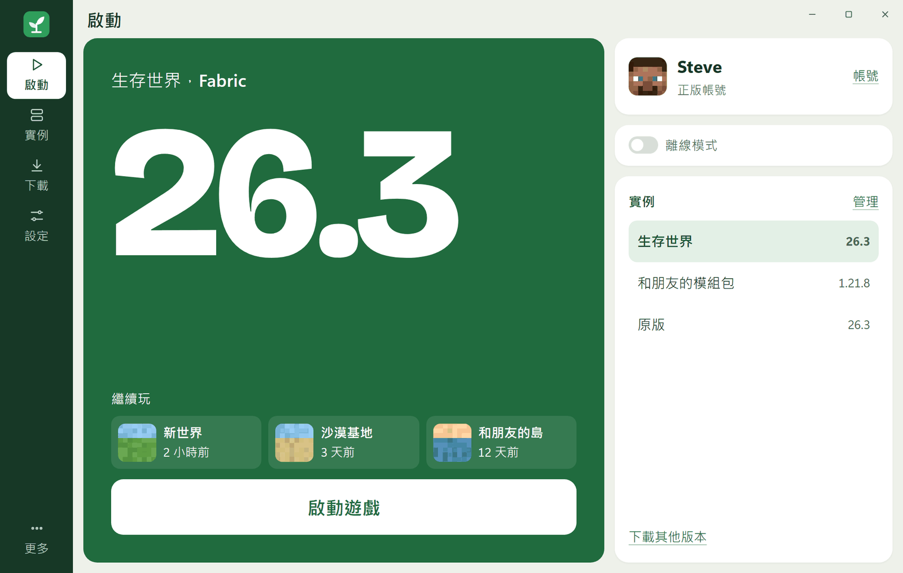
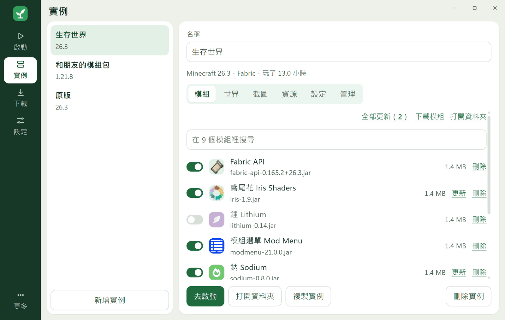
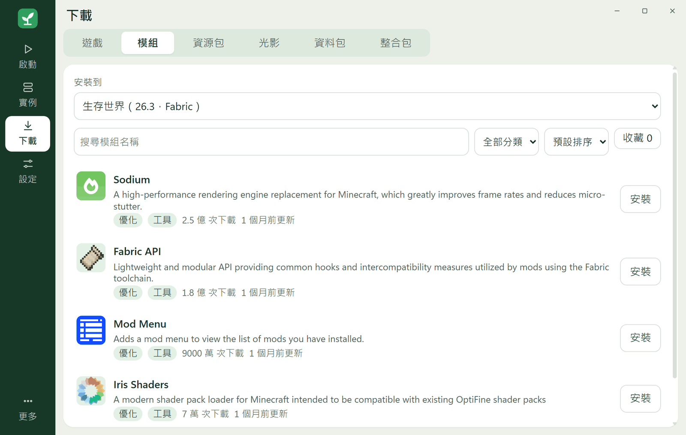
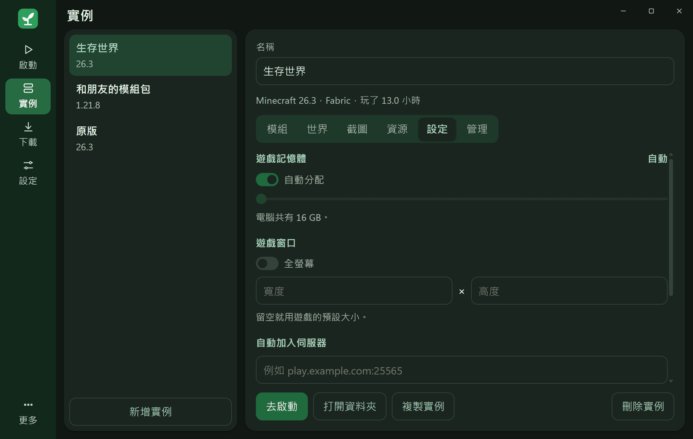
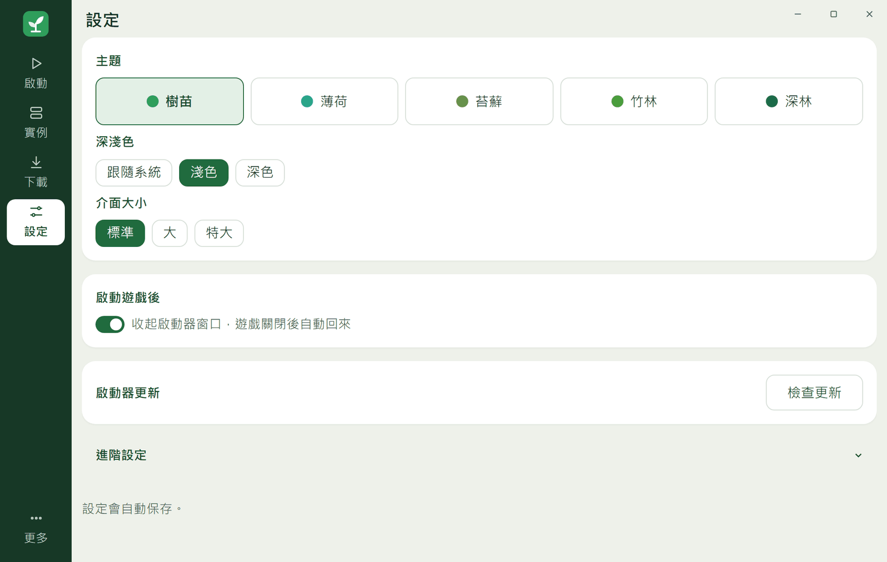
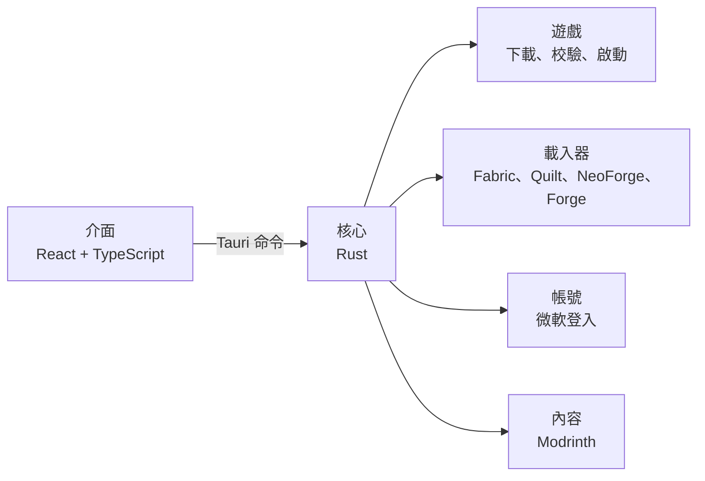

<p align="center">
  
</p>

<p align="center">
  <a href="https://github.com/PZW152/sapling/releases/latest"></a>
</p>

<p align="center">
  <a href="https://github.com/PZW152/sapling/releases/latest"></a>
  <a href="https://github.com/PZW152/sapling/releases"></a>
  <a href="https://github.com/PZW152/sapling/actions/workflows/ci.yml"></a>
  
  
</p>

<p align="center">
  <a href="https://pzw152.github.io/sapling/">官網</a> ·
  <a href="#功能">功能</a> ·
  <a href="#開始使用">開始使用</a> ·
  <a href="#常見問題">常見問題</a> ·
  <a href="#技術架構">技術架構</a>
</p>

<br>

Sapling 是 Minecraft Java 版啟動器。單一 exe，約 10 MB，不用安裝。

<p align="center">
  
</p>

## 功能

<p align="center">
  <picture>
    <source media="(prefers-color-scheme: dark)" srcset="assets/readme/home-dark.png">
    
  </picture>
</p>

### 玩遊戲

- 正版微軟帳號登入，可以保存多個帳號並切換，也能在啟動器裡換皮膚
- 支援 1.7.10 以後的正式版和快照版，遊戲檔案全部校驗，已安裝的版本沒有網路也能玩
- 首頁按一下進世界或伺服器（進世界需要 1.20 以上），可以建立桌面捷徑
- 離線模式：這台電腦登入過擁有遊戲的微軟帳號後，可以用自訂名稱玩單人遊戲和區域網路

### 模組和整合包

<table>
  <tr>
    <td width="50%"></td>
    <td width="50%"></td>
  </tr>
</table>

- 支援 Fabric、Quilt、NeoForge 和 Forge
- 從 Modrinth 下載模組、資源包、光影、資料包和整合包，前置模組自動裝好
- 熱門模組顯示中文名，也能用中文搜尋
- 檢查模組更新，一鍵全部更新，不會把正式版換成測試版
- 匯入和匯出 `.mrpack`，檔案拖進窗口就能安裝

### 實例管理

<table>
  <tr>
    <td width="50%"></td>
    <td width="50%"></td>
  </tr>
</table>

- 每個實例有獨立的存檔、模組和設定，各自設定記憶體、窗口大小、Java 和自動加入的伺服器
- 複製實例、更換遊戲版本和載入器、一鍵修復遊戲檔案
- 備份世界，從官方啟動器或舊版 Sapling 匯入世界
- 記錄遊玩時間，最近玩過的排前面
- 相同的檔案不重複下載，用不到的一鍵清理

### 介面

- 五種綠色主題，淺色、深色或跟隨系統
- 三種介面大小，支援鍵盤操作、讀屏軟體和 Windows 高對比模式
- 毛玻璃窗口，可改成雲母或純色
- 彈簧曲線動畫，跟隨系統的「減少動畫」設定

### 下載和更新

- 遊戲檔案全部校驗，大檔案分段下載，斷線只補缺少的部分
- 下載走 Windows 系統代理
- 自動更新，下載後校驗 SHA256
- 崩潰時說明可能原因，指出可能有問題的模組

## 開始使用

1. 到 [Releases](https://github.com/PZW152/sapling/releases/latest) 下載 `SPL-版本號.exe`
2. 放進一個資料夾，直接打開
3. 登入微軟帳號，按「開始玩」

遊戲和設定會存在同一個資料夾的 `Sapling Data` 裡。需要 Windows 11 x64，以及正版 Minecraft Java 版。

## 常見問題

<details>
<summary><b>打開時 Windows 說「已保護您的電腦」？</b></summary>
<br>
Sapling 是學生的個人專案，沒有購買數位簽章。按「其他資訊」再按「仍要執行」就能打開。想確認檔案沒被改過，可以比對 Release 頁面上的 SHA256，程式碼也都公開在這裡。
</details>

<details>
<summary><b>可以不用正版嗎？</b></summary>
<br>
不行。Sapling 不支援盜版，也沒有免帳號登入。離線模式只給這台電腦登入過擁有遊戲帳號的人使用。
</details>

<details>
<summary><b>下載很慢或連不上？</b></summary>
<br>
下載會走 Windows 的系統代理。連不上官方伺服器時，請先開啟代理或加速器。
</details>

<details>
<summary><b>登入資料存在哪裡？</b></summary>
<br>
登入走微軟官方的裝置代碼流程，密碼不會經過 Sapling。登入憑證只存在 Windows 憑證管理員，不會寫入檔案，也會從遊戲日誌裡移除。
</details>

<details>
<summary><b>怎麼回報問題？</b></summary>
<br>
到「更多」頁複製診斷資訊，再<a href="https://github.com/PZW152/sapling/issues/new/choose">回報問題</a>。診斷資訊裡沒有帳號資料。
</details>

<details>
<summary><b>有 macOS 或 Linux 版嗎？</b></summary>
<br>
目前只支援 Windows 11 x64。
</details>

## 技術架構

核心邏輯（Rust）和介面（Tauri 2、React、TypeScript）分開，每個功能是獨立模塊。



開發方向見 [設計與開發原則](DESIGN.md)，版本規則見 [版本號規範](VERSIONING.md)，改動記錄見 [更新日誌](CHANGELOG.md)。

<details>
<summary><b>從原始碼建置</b></summary>
<br>

需要 Rust（MSVC 工具鏈）、Node.js 和 Microsoft C++ Build Tools。

```bash
cd app
npm install
npm run tauri dev
```

</details>

## 授權

Copyright (c) 2026 PZW152。本專案代碼公開，但不是標準開源軟體。

歡迎學習和善意參考：少量參考請署名；修改版和大量參考必須遵守 [善意使用指南](USAGE.md)，包括說明是第三方作品、公開原始碼和不收費。不可以冒充官方、倒賣，或用於訓練 AI。

完整條款見 [LICENSE](LICENSE)，AI 工具請參閱 [AGENTS.md](AGENTS.md)，使用的開源軟體見 [第三方授權](THIRD-PARTY-NOTICES.md)。

<sub>非 Minecraft 官方產品，與 Mojang 和 Microsoft 無關。模組和整合包資料來自 <a href="https://modrinth.com">Modrinth</a>。</sub>
